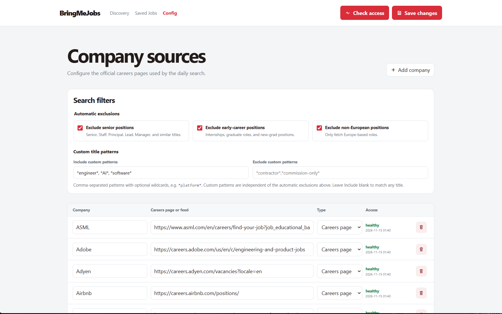

# BringMeJobs

BringMeJobs is a local job-discovery dashboard. It scans career sources you
configure, filters listings by location and title, and lets you review, save, or
discard jobs from a simple web interface.

## Screenshots

**Discovery**


**Config**



## What it can do

- Add, edit, and remove company career pages or job feeds.
- Check source access and view the last check status.
- Search for job listings with optional exclusions for senior, early-career, and
  non-European roles, plus custom title include/exclude patterns.
- Browse new listings in **Discovery**, save interesting roles, and discard
  listings you do not want to see again.
- Deduplicate by canonical job URL. Discarded listings keep their identifier and
  URL key so they are not rediscovered.
- Filter by title, company, or location, and sort by posting date, match score,
  or company name.
- Review search-run logs and source errors.

Career-site connector coverage is still in progress. Some sources may need a
dedicated connector, and blocked or unsupported sources are reported rather
than treated as successful fetches.

The app does not submit job applications for now, but in the future I will automate that too.

## Run locally

Requires Python 3; no third-party Python packages are needed.

```bash
python3 bringmejobs.py migrate
python3 bringmejobs.py serve
```

Open [http://127.0.0.1:6767](http://127.0.0.1:6767) (SIX-SEVEEEN), then use **Config** to add
career sources and adjust title filters. Click **Run search** in the header to
scan them, or run the dispatcher from a separate terminal:

```bash
python3 -m src.dispatcher
```

The local database and logs are stored under `data/`.

## Windows startup

The optional **BringMeJobs** logon task starts the web interface, waits for it
to respond, then starts a search after 60 seconds. Register the task with:

```powershell
powershell.exe -NoProfile -ExecutionPolicy Bypass -File scripts/register-windows-startup.ps1
```

Adjust the WSL distro and repository path in `scripts/windows-startup.ps1` if
needed.
